# Kiosk – order management for the Quickbox kiosks (1991–1995)

**Kiosk** ("Kioskverwaltung") is an MS-DOS program I wrote from 1991 to 1993
in Turbo Pascal 6.0 with Turbo Vision. It was custom software for
**Norkus & Blaaß**, the company in Barsinghausen near Hanover behind
**Quickbox Kiosk & Imbiss**, a chain of franchised kiosks and snack bars.
Its successor **WAWIS** ("Wawis – Das Warenwirtschaftssystem") is a
Windows 3.1 rewrite from 1994/95 and is part of this repository too.

This repository holds every version that survived on my old backups, the
story behind them, and what it takes to build and run them today.

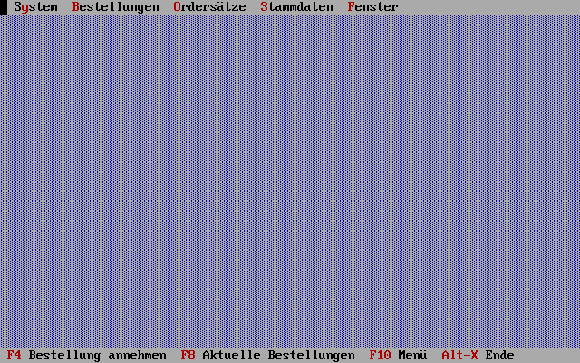

## Contents

- [Screenshots](#screenshots)
- [The story](#the-story)
- [Looking back](#looking-back)
- [Version history](#version-history)
- [How it worked](#how-it-worked)
- [WAWIS, the Windows successor](#wawis-the-windows-successor)
- [The lost units and their reconstruction](#the-lost-units-and-their-reconstruction)
- [Building and running it today](#building-and-running-it-today)
- [Notes on this archive](#notes-on-this-archive)
- [License](#license)

**[Try Kiosk in your browser](https://zordid.github.io/kiosk/)** – Kiosk
1.2C in DOSBox, ready to take an order.

[](https://archive.softwareheritage.org/browse/origin/?origin_url=https://github.com/Zordid/kiosk)

How it all works inside, and what was reconstructed for building and
running it again, is in [docs/INTERNALS.md](docs/INTERNALS.md).

## Screenshots

### Kiosk

Kiosk 1.2C in DOSBox-X in 2026, with the article data of 1993 and an
invented customer, on a DOS clock set to 26 November 1993.

| | |
|---|---|
| 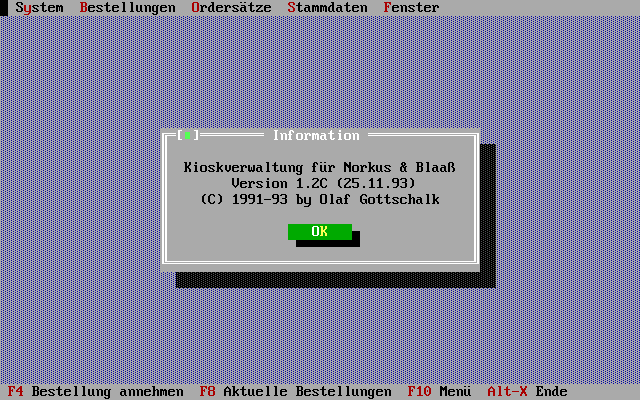 | 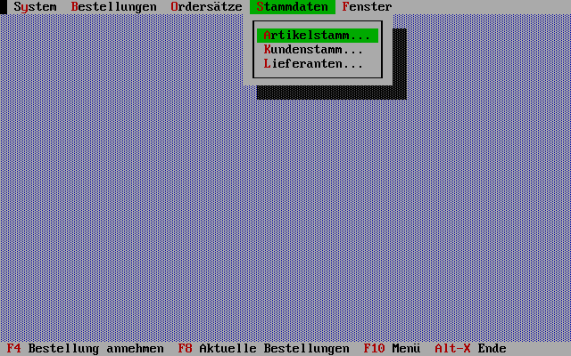 |
| The about box | Master data menu |
| 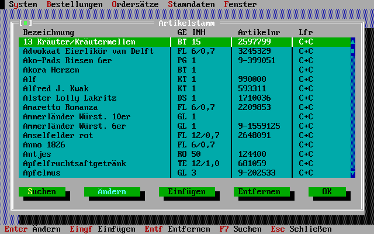 | 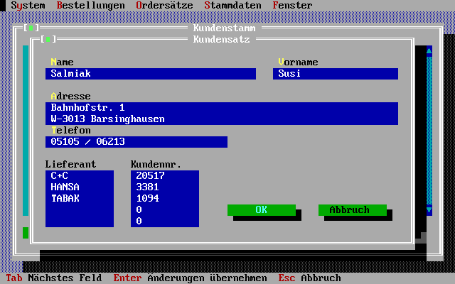 |
| Articles, searchable by typing | A customer (a kiosk) and its customer numbers with the wholesalers |
| 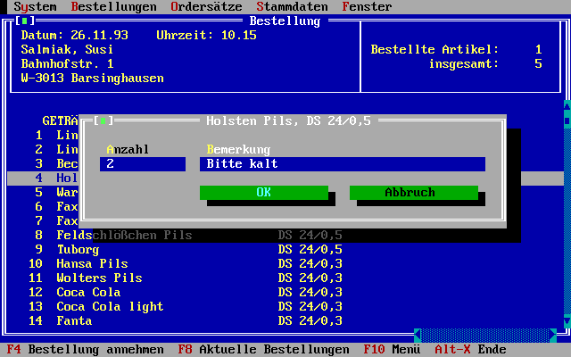 | 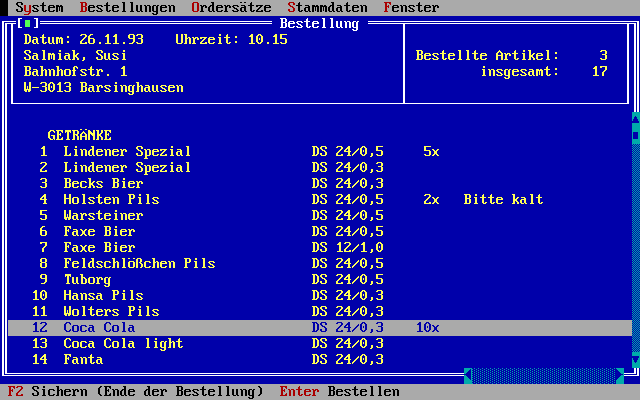 |
| Taking an order: quantity and remark | The order on the order set |
| 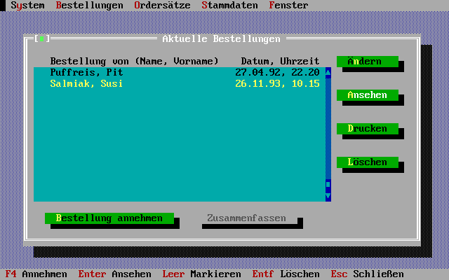 | 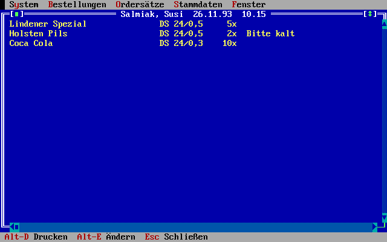 |
| Current orders | An order, ready to print |

The printed order for the wholesaler is in [docs/printout.txt](docs/printout.txt).

### WAWIS

WAWIS 1.1 on Windows for Workgroups 3.11 in DOSBox-X in 2026, with the
data of 1994/95 (the franchisees' names replaced by made-up ones from the
kiosk shelf, like "Kandis, Kai", phone numbers that cannot exist, the
towns kept),
on a clock set to 7 August 1995.

| | |
|---|---|
| 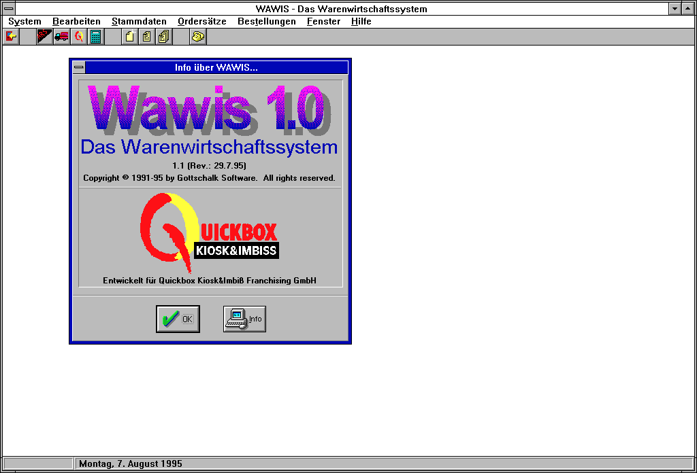 | 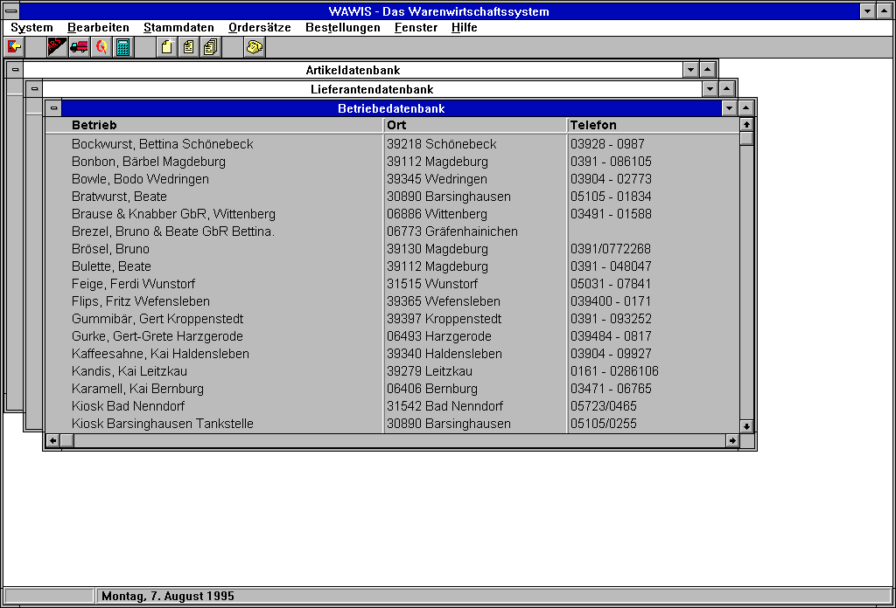 |
| The about box: version 1.1 of 29 July 1995, still with the 1.0 logo | Articles, wholesalers and outlets in MDI windows |
| 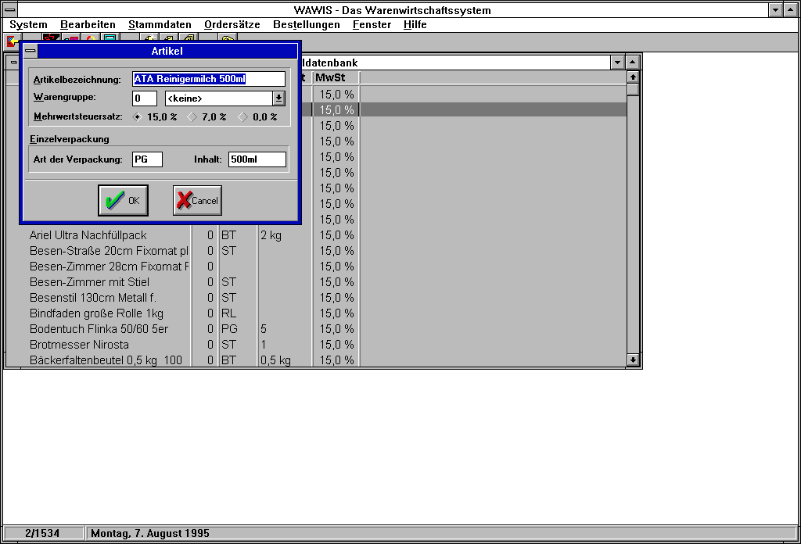 | 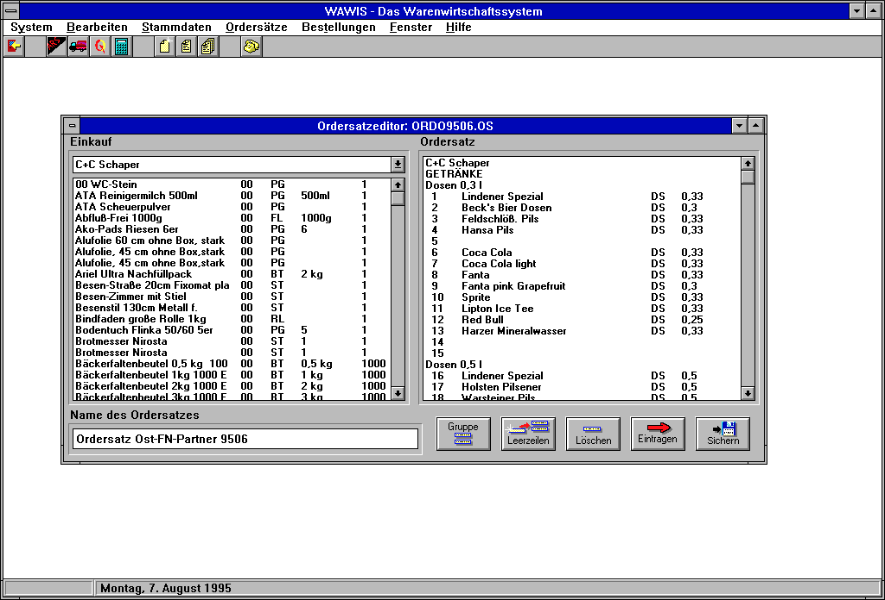 |
| An article in a BWCC dialog | The order set editor: a wholesaler's purchase list (left), the numbered order form (right) |
| 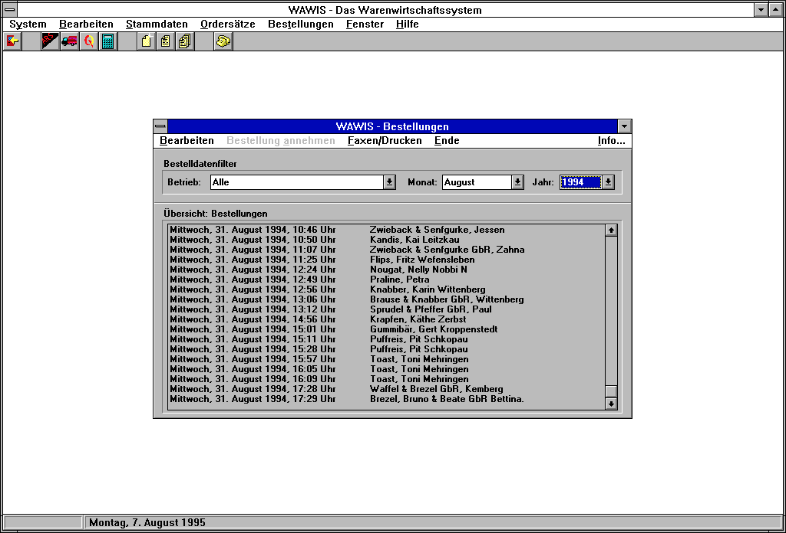 | 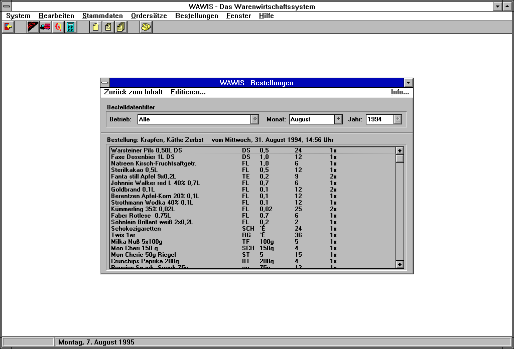 |
| Orders of 31 August 1994 | One of them |
| 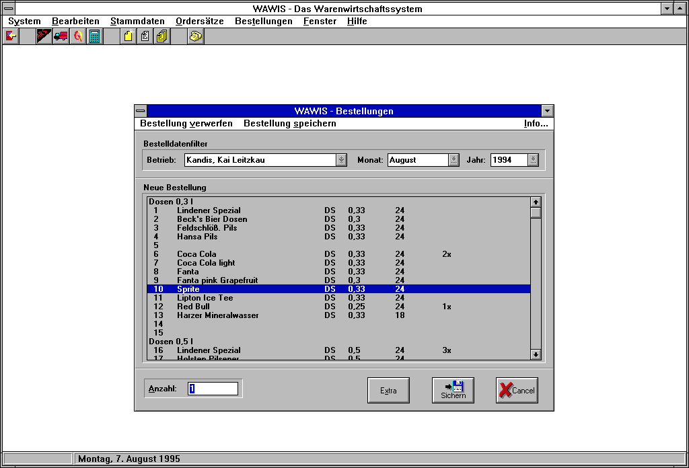 | 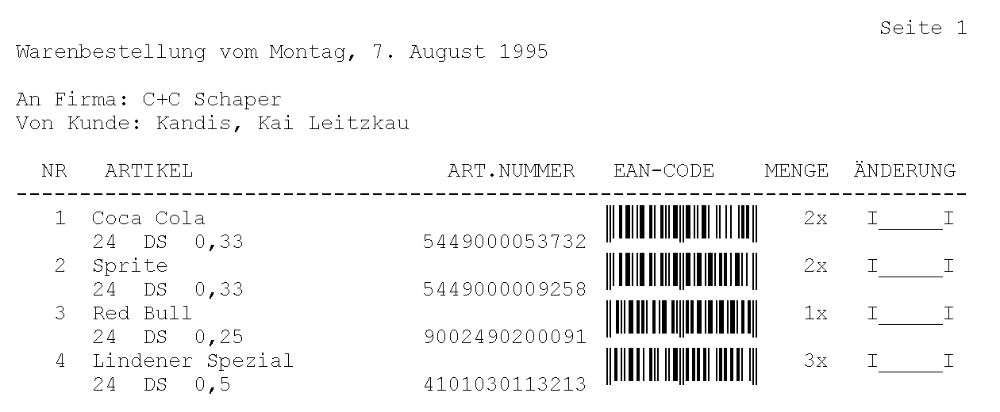 |
| Taking an order: line number on the order form, then quantity | The printed order for the wholesaler |

The printout came out of DOSBox-X's emulated Epson printer, and its EAN-13
barcodes still scan.

## The story

In 1991, when I was 18, a friend's father mentioned a problem he saw at
work. He was with C+C Schaper, a cash-and-carry wholesaler in Hanover
that supplied the Quickbox kiosks. (Founded in Hanover in 1879, Schaper
later became part of Metro; the brand was dropped in 2015, and its last
markets became Metro Gastro stores.) The kiosks were run by franchisees, and
there were no PCs in places like that yet, let alone networks: every kiosk
phoned its order in to the Quickbox headquarters, Norkus & Blaaß in
Barsinghausen. There the order was written down on paper, and the paper
went to C+C Schaper.

That was the job: a program for the headquarters that makes taking an
order on the phone fast, and turns the orders into clean orders for the
wholesalers. My contact at Norkus & Blaaß was one of the two owners. Kiosk
was in daily use there from 1991/92 until about 1994, through the versions
in this repository.

The order editor shows why it was quick: the order set is the same
numbered list the kiosk has in front of it, so the person at the phone
moves to the position that is read out, presses Enter, types the quantity,
and goes on. At the end, Kiosk prints one page per wholesaler, with the
kiosk's own customer number there, ready for the fax.

What the archive adds:

- The first version greets its users with *"Kioskverwaltung für
  Norkus & Blaaß – (C) 1991 by Olaf Gottschalk"*. The surviving sources of
  1.0 are dated March 1992, the last DOS version, 1.2C, November 1993.
- The order sets of the test data are called "Quick", and the test order
  of April 1992 comes from a kiosk in Saxony-Anhalt (postcode with the
  "O-" prefix used in eastern Germany until July 1993).
- In 1995 the outlets file of WAWIS lists franchise kiosks mostly in
  Saxony-Anhalt – Zerbst, Bernburg, Wittenberg, Kemberg, Wernigerode,
  Harzgerode, Schönebeck and more – and a few near Hanover. Quickbox was a
  chain that grew in the years after German reunification.
- The company behind it appears in the Hanover commercial register as
  QUICKBOX Franchising GmbH in Barsinghausen (still with a share capital in
  Deutsche Mark); it was renamed in 2007 and dissolved in 2016.
- Some Quickbox kiosks are still open today, in Haldensleben, Magdeburg
  and Wittenberg – all towns on the 1995 list. The one in Zerbst/Anhalt
  closed around 2019.
- WAWIS 1.1 was finished in July/August 1995 under the name
  "Gottschalk Software", "(c) Copyright 1991-1995".

## Looking back

### A side job at eighteen

I wrote Kiosk and WAWIS entirely at home, on my own PC. In 1991 that was
probably my first 386, the successor of the XT clone that Power-Choice was
born on. BCS, the computer dealer I worked for alongside, had nothing to
do with this project, but now and then I got newer hardware from them, and
that helped. The job itself was a small side job with a marginal
employment contract. "Gottschalk Software" in WAWIS's about box was the
idea of an eighteen-year-old: a nice name, never anything official.

### Evenings in Barsinghausen

The programming happened at home; then I drove to Barsinghausen for the
next meeting and installed the new version from floppy disks. Turbo
Pascal never went there. The program was used every day by the employees
in the office, but I don't remember any of them: I always came in the
later hours, when the office was quiet, and sat with one of the two
owners in front of a PC, pondering features and processes. He was a heavy
smoker, and of course the boss of a kiosk chain had easy access to
cigarettes by the carton. Staying with him for long was not easy. ;-)

He once hired me for something completely different: test purchases. I
drove around from Bad Nenndorf to Hanover and bought cartons of cigarettes
at kiosks, to see whether the staff rang the sale up in the till or put
the money in their own pockets. A strange job for a convinced non-smoker,
or rather a smoking hater. I never saw one of the new kiosks in the east.

### From Turbo Vision to Windows

By 1994 it was time to lift DOS programs to Windows, and to keep the data
on a network share. Norkus & Blaaß had a Novell network, so the network
features of WAWIS were a perfect fit. I had no clue how to do it, until I
found Novell's Btrieve book at BCS, which sold Novell network gear. I read
it, saw that it came with Pascal libraries, and used Btrieve to replace
the record manager I had written for Kiosk.

It was not an easy time for Borland and Pascal, the years before Delphi.
Borland Pascal for Windows felt awkward, unfinished and cumbersome. Turbo
Vision on DOS had been a much cleaner way of doing objects: the Windows
user interface was not designed around objects, and you could feel it in
every window. Delphi filled that gap later.

The orders never touched paper again: WAWIS sent them through a fax
printer driver, and Norkus & Blaaß never printed a single page. The
barcodes were for the wholesaler, who could scan them off the fax while
packing. And the voice prompts? I don't know what the office thought of
them. It would have driven me mad to hear my own voice a million times a
day while taking orders: what a creepy feature!

### How it ended

I was called whenever new features were needed. At some point, nobody
called any more. Maybe a bigger product replaced WAWIS in the mid-1990s; I
never found out. One thing I can say for sure: WAWIS was no longer in use
in 2000. Its orders window would have broken on the new year (see the
review below), and nobody called. By then I was living in Munich and had
started working for BMW.

### Reading it again

Looking at the code again, my fingers remember things. Pascal wanted a
pointer type for every record and object, `PKunde = ^TKunde` right above
`TKunde = Object(TStammItem)`, and I typed that pair so often that I can
still feel the movement.

The few German comments made me laugh. Today, when somebody shows me code
with German comments, I cannot hold back from pointing out that no-go.
Back then most of mine were English, but not all. And I would never again
name things `TKunde` or, worse, `TStammItem`: half German, half English,
a horrible Denglisch word.

What I don't like any more are the long procedures with lots of paths
through `if … then begin … end else if …`. Pascal had a `case` statement,
but only for numbers, characters and enumerations, so everything else
ended in chains of ifs. And Pascal does not care whether you write
`BEGIN`, `Begin` or `begin`. I did care, it seems, just not consistently:
until 1993 I wrote `Begin`; in WAWIS the newer units have `begin`, while
the database layer and the window framework (`DBSERVER`, `DBEDITOR`,
`LISTWIN`, `MDITOOLS`) still use `Begin`. You can watch the switch happen
inside one program. My style has changed a lot since then.

And then there are the exclamation marks. I put a space before them, like
this ! Power-Choice 1.0 did it 24 times and even greeted its users with
`Welcome to Power-Choice !!`. Version 3.1 was almost cured, but the habit
came back: Kiosk says `Ordersatz konnte nicht geladen werden !`, and WAWIS
shouts `!! Artikel gelöscht !!`. I would never in the world do that again.
How horrible.

The real shock was in `ARTIKEL.PAS`: the purchase and sales prices are
`Real`, floating point numbers. In WAWIS they are even `Single`, with only
about seven significant digits. Money in floating point! I obviously knew
nothing about that problem back then. Luckily it never mattered: Kiosk
never stored a price, and WAWIS never calculated with one (see the review
below).

My message to the eighteen-year-old in Barsinghausen: nice job again, all
good the way you did it. And when Windows and Borland Pascal get
cumbersome: wait a few months! Delphi is going to come and help you!

### A code review, three decades late

*Olaf asked Claude for a review of Kiosk and WAWIS, and of how his style
had changed since Power-Choice. Here it is.*

**Verdict: approved, with comments.**

How the style evolved, in numbers (my own code only, without the Borland,
BTP and c't units):

| | Power-Choice 1.0 (1990) | Power-Choice 3.1 (1993) | Kiosk 1.2C (1993) | WAWIS 1.1 (1995) |
|---|---|---|---|---|
| Lines | 5,175 | 3,998 | 5,848 | 8,851 |
| Object types | 12 | 18 | 43 | 62 |
| Virtual methods | 2 | 53 | 118 | 254 |
| `goto` | 7 | 2 | 0 | 0 |
| Comments per 1,000 lines | 6 | 21 | 14 | 17 |

What works:

- **From objects to frameworks.** Power-Choice 1.0 used objects as records
  with procedures. Kiosk builds its own small framework on Turbo Vision:
  `TStammItem`, `TStamm`, `TStammViewer` and `TItemDialog` carry all the
  master data, and articles, customers and wholesalers are thin
  descendants. WAWIS goes one step further: `TDatabase` reads a Btrieve
  table into memory and notifies every registered window when a record
  changes – the observer pattern, and data-aware windows, before Delphi
  had them.
- **Built for the person at the phone.** Kiosk's order editor jumps to a
  line as soon as you type its number (`OSVIEWS.PAS`, up to four digits),
  Enter asks for the quantity, and that is all. WAWIS keeps exactly this
  flow. The best user interface decisions in both programs come from
  watching how the job is really done.
- **A record manager of your own, then the courage to drop it.** Kiosk's
  `DATAFILE.PAS` is a compact fixed-record file with a free list, and its
  indexes rebuild themselves when damaged. When the network came, WAWIS
  replaced all of it with Btrieve instead of stretching it further.
- **Network-ready.** Records are locked while they are edited, and a
  locked record (Btrieve status 84) gets a "try again?" dialog instead of
  a crash.
- **Names for things.** The Epson codes in Kiosk are constants
  (`ThickOn`, `WideOn`), the Windows messages in WAWIS are named
  (`wm_DBMessage`). Power-Choice 1.0 still wrote `256+72`.

Requested changes:

- **Comments, still.** Better than 1990, but `MAKEREZ.PAS` (604 lines) and
  `DRUCKER.PAS` have none, and the Btrieve and stream formats had to be
  reconstructed from the code in 2026.
- **A crash on an empty list.** A letter typed into an empty master-data
  list stops Kiosk with runtime error 213: `STAMM.PAS` reads the focused
  item of a collection that has none.
- **The year 2000, half done.** `GetFileName` in WAWIS already knows that
  the year after 1999 is 00. The year list of the orders window, however,
  ends in 1999, and in January 2000 it would have selected an entry that
  does not exist.
- **Money in floating point.** Kiosk keeps purchase and sales prices as
  `Real` (6 bytes, 11 to 12 digits), WAWIS its prices as `Single` (4 bytes,
  about 7 digits). Most prices cannot be stored exactly: of 570 prices in
  WAWIS's purchase list only 64 are; 2.29 DM is in the file as
  2.28999996185302734375. Nothing went wrong, by luck, not by design: in
  Kiosk 1.2B and 1.2C the price input line is a stub that stores zeros
  (all 795 articles of the test data cost 0.00), and WAWIS only stores and
  shows its prices, rounded with `Str(Preis:0:2)`, and never calculates
  with them. Had it done so, with these prices: `Trunc(Preis * 100)` gives
  the wrong number of pfennigs for 31 of them (16.88 becomes 1687), adding
  ten of each article in `Single` is 0.93 DM off, adding 15 % VAT and
  rounding comes out wrong for 30 of them, and above about 65,000 DM a
  total can no longer hold the pfennigs (65,535.99 is stored as
  65,535.98828125). The fix was available then: whole pfennigs in a
  `LongInt`, or Turbo Pascal's `Comp`; Delphi later added `Currency`.
- **Fixed-size buffers.** Paths go into `array[0..200] of Char` with
  `StrCopy` and `StrCat`, unchecked. That was the Windows 3.1 way, but it
  is one long path away from overwriting memory.
- **Leftovers.** An unused `acMonth` in `GetFileName`; `TESTBAR.PAS`
  prints a test barcode on a hard-coded Olivetti JP 350S.
- **Tests: none.** Forgiven again, for the same reasons as in 1990. The
  test suite was an owner, a fax machine and a wholesaler with a barcode
  scanner.

Verified: in 2026 Kiosk compiles with Turbo Pascal 6.0, WAWIS with Borland
Pascal 7.0, and both run. Ship it.

## Version history

| Version | Date | Archive | Notes |
|---|---|---|---|
| Kiosk 1.0 | 19 Mar 1992 | `KIOSK10.ARJ` | 15 units, 5,570 lines. About box: "(C) 1991". A clock in the menu bar. |
| Kiosk 1.2 | 31 May 1992 | `KIOSK12.ARJ` | 5,636 lines. Version number and date in the about box; printer option for an HP DeskJet. |
| Kiosk 1.2B | 8 Jun 1993 | `KIOSK12B.ARJ` | Adds `DATAFILE.PAS`; my own `Fields` unit is replaced by Borland's Turbo Vision forms demo unit plus a stub for real numbers. |
| Kiosk 1.2C | 25 Nov 1993 | `KIOSK12C.ARJ` | 6,029 lines. Last DOS version, with a `TEST` folder of real working data. |
| WAWIS 1.1 | 29 Jul 1995 | `Wawis.zip` | Windows 3.1 successor, 10,300 lines, with its data, order sets and sounds. |

Each version is a commit dated with its original date and tagged
(`v1.0`, `v1.2`, `v1.2b`, `v1.2c`, `wawis-1.1`).

## How it worked

Kiosk is built for a central office that takes the orders of many kiosks
and passes them on to the wholesalers, each with the kiosk's own customer
number there.

- **Master data** (*Stammdaten*): articles with unit, contents, article
  number and wholesaler; customers – the kiosks – with up to five customer
  numbers, one for each wholesaler; wholesalers with phone and fax numbers.
  Long lists can be searched by typing the first letters.
- **Order sets** (*Ordersätze*): an order set is the order form – groups like *Getränke* with numbered positions. Order sets get
  a "valid from" date; when an order is taken, the program picks the active
  set that is valid today. A kiosk can also get positions of its own
  (*kundenspezifisch belegen*).
- **Taking an order** (F4): choose the kiosk, and the order editor shows the
  order set; Enter on a position asks for the quantity and a remark. F2
  saves the order.
- **Current orders** (F8): the list of orders not yet passed on, by kiosk,
  date and time. Orders can be viewed, changed, printed, deleted, or
  combined into one summary (*Zusammenfassen*).
- **Printing**: for every wholesaler, one page in Epson printer codes, ready
  to fax: the wholesaler with phone and fax, the kiosk and its customer
  number with that wholesaler, then article, unit, article number and
  quantity, with a box per line for corrections – see
  [docs/printout.txt](docs/printout.txt).

Technically, Kiosk is a Turbo Vision application. Its menus, status line
and dialogs are built by a second program, `MAKEREZ.PAS`, and stored in a
resource file, `KIOSK.REZ`.

### How Kiosk stores its data

Kiosk has no database system; everything is built from Turbo Pascal files
and Turbo Vision objects:

- **Master data** – articles, customers, wholesalers – are files of
  fixed-size records (`ARTIKEL.DAT`, `KUNDEN.DAT`, `LIEFER.DAT`), handled by
  my unit `DATAFILE.PAS`. Record 0 is a header with the record size and a
  list of free records: a deleted record joins the list and is reused by
  the next insert. Records are addressed by their number.
- **Indexes** are kept in memory: a sorted Turbo Vision collection with one
  item per record – the search key (for articles: name and contents, in
  upper case) and the record number. On exit, the collection is written to
  an index file (`ARTIKEL.IDX` …) as a stream and read back on the next
  start. If the index is missing or damaged, Kiosk rebuilds it from the
  data file. Started with `/A`, it also compacts the article file and drops
  deleted records.
- **Orders and order sets** are Turbo Vision streams: each order is one
  file (`ORD0001.ACT` …) with the order as an object, and the list of
  current orders (`ORDINDEX.ACT`) and of active order sets (`OSINDEX.ACT`)
  are stored collections.

It is a single-user design: one PC at the headquarters, all data in the
program directory, the whole index in memory.

## WAWIS, the Windows successor

[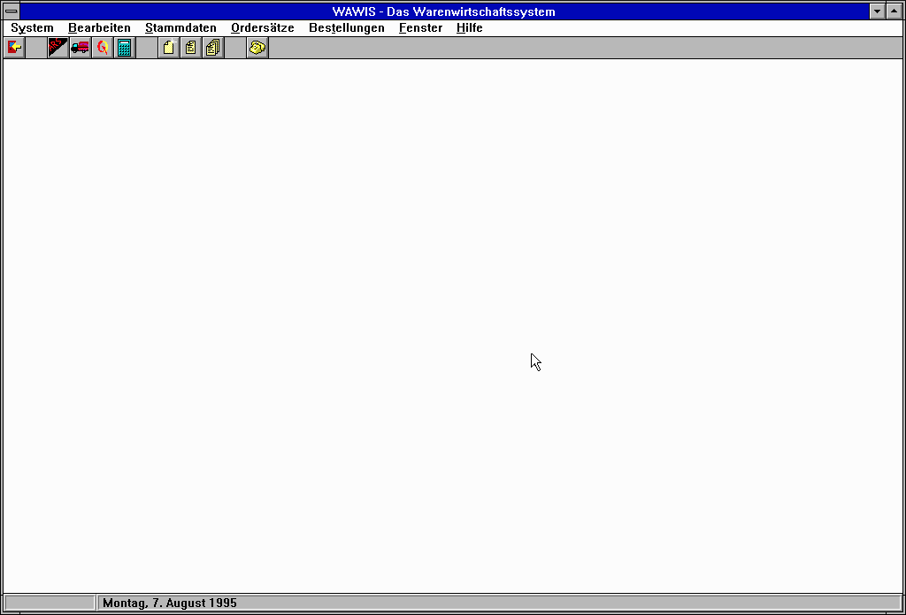](docs/recordings/wawis-order-1.1.mp4)

*Click the animation for the video with sound: my voice saying "Anzahl!"
and "Nummer!", and the error sound for an empty line on the order form.*

By 1994, Windows was becoming dominant, so the next version had to be a
Windows 3.1 program. I wrote it – in the middle of the multimedia hype,
which is why WAWIS talks: while somebody types in an order, my own voice
says "Nummer!" and "Anzahl!" to keep them on track. I don't remember much
of what became of WAWIS, nor whether it ever fully replaced Kiosk. Its
data files suggest it was used: the order file for August 1994 holds
106 orders from 23 kiosks, and the order sets go from May 1994 to July
1995. Running it again in 2026 showed a finished program: its about box
says version 1.1 of 29 July 1995 (the logo still says 1.0), and the
active order sets are "Ordersatz West" and "Ordersatz Ost-FN-Partner",
evidently for the outlets in the west around Hanover and in the east,
from Magdeburg to Wittenberg.

WAWIS ("Warenwirtschaftssystem", inventory management) is the same task as
a Windows 3.1 program, written with Borland Pascal 7 and ObjectWindows:
an MDI application with Borland's BWCC dialogs, a Btrieve database, a
purchase price list (*Einkauf*), the franchise outlets (*Betriebe*), order
sets and orders, printing and faxing – one page per wholesaler, with an
EAN-13 barcode for every article – and the spoken prompts
(`NUMMER.WAV`, `ANZAHL.WAV`, `HALT.WAV`, `TEL_LAUT.WAV` – my voice). The source headers say *"Warenwirtschaftsprogramm
für Windows 3.1 … created for Quickbox Kiosk & Imbiss"*.

The barcodes were something special back then, and new with WAWIS: Kiosk
printed plain text on a dot-matrix printer, while under Windows I could
finally print graphics, so `BARCODES.PAS` draws an EAN-13 code next to
every article. The order was faxed to the wholesaler, and there they could
simply scan the codes off the fax to check the order while packing it.

Besides its own folder, WAWIS uses three units that I kept with my other
Borland Pascal units and that are now next to it: `MDITOOLS.PAS` (a toolbar
and a status line for MDI windows) and `WAITDLG.PAS` (a progress dialog),
both mine, and `CTL3D.PAS`, a unit for Microsoft's 3-D controls published
in the computer magazine c't in November 1994. In 2026 WAWIS was built
again with Borland Pascal 7.0 and runs on Windows for Workgroups 3.11, with
Novell's Btrieve 5.10a for DOS behind a small requester DLL written for the
purpose – see [docs/INTERNALS.md](docs/INTERNALS.md).

For the Btrieve database, WAWIS uses `BTPWIN.PAS`, my Windows version of
**BTP**, *"the Btrieve Unit for Turbo Pascal"* by John C. Leon (version 2.0,
June 1993, shareware). The objects, constants and many comments are BTP's;
I replaced its DOS call into Btrieve with calls into Novell's
`WBTRCALL.DLL`, Btrieve for Windows. BTP's own low-level call in turn is
Novell's Turbo Pascal interface, `TUR5BTRV.PAS`.

### How WAWIS stores its data

WAWIS is not a Delphi program – it is Borland Pascal 7 with ObjectWindows,
and the database layer is my own unit `DBSERVER.PAS` on top of BTP:

- The tables (`ARTIKEL.WD`, `LIEFER.WD`, `BETRIEBE.WD`, `EKLISTE.WD`,
  `GLOBALS.WD`) are **Btrieve files**: records with keys that Btrieve
  maintains itself, so the hand-made index files of Kiosk are gone.
- A `TDatabase` object reads a table into a buffer in memory and keeps up
  to five sort orders of it, one per key.
- Windows register with a table. When a record is inserted, changed or
  deleted, every registered window gets a message and redraws itself, so
  two windows on the same data stay in step – much like the data-aware
  controls Delphi would bring a little later.
- WAWIS was built for a **network**: records are locked while they are
  edited, a locked record (Btrieve status 84) gets a "try again?" dialog,
  and the messages speak of order sets and settings being edited "on
  another station" or "in the network".

Delphi 1 came out in February 1995, while WAWIS 1.1 still had changes in
July 1995. My first Delphi projects on the same backups are from 1995 too,
for BCS, and they use Delphi's own database components; the BCS
Warenbestellsystem keeps its data in Paradox tables.

## The lost units and their reconstruction

Kiosk used a small library of my own that I kept elsewhere – the same one
Power-Choice uses – and none of it survived: `StrObj`, `StrUtl`,
`DosTools`, `DateUtl`, `StackDmp`, and for 1.0/1.2 also the older `Fields`
and `StreamEr`. In 2026 I rebuilt them in [`lib/`](lib/), so that all four
DOS versions can be compiled again.

The interfaces follow the calls in Kiosk and Power-Choice. The binary
layout comes from the surviving data files, so the rebuilt units read and
write files exactly as in 1992/93:

- `TStr` is a `TObject` holding one string pointer; a record that contains
  one is written with its VMT word, then the string (`TStream.WriteStr`).
  Object ID 1000.
- `TDate` is stored as day, month, year and `TTime` as hour, minute,
  second, each a 16-bit word. `TDate` has the object ID 1001 (both IDs are
  listed in Power-Choice's `OBJID.TXT`). Dates are shown as `DD.MM.YY`.

The bodies of the routines are new, and each file says so in its header.
Some details are guesses: what the Boolean of `TDateInputLine.Init` meant,
the object IDs of the old `Fields` unit, and what `StackDmp` and `StreamEr`
did beyond what their names say. `HeapView` and `ClkView` pass on the views
of Borland's `Gadgets` demo unit.

Tested in 2026 with the 1993 test data: all four versions start, load the
current orders, the master data and the order sets; a new customer and a
new order are saved, listed, viewed and printed, and the saved order file
has the same layout as the one from 1992. One original bug turned up:
typing a letter into an *empty* master-data list stops the program with
runtime error 213, because the incremental search reads the focused item
of an empty collection.

## Building and running it today

The easiest way to try Kiosk is the [browser demo](https://zordid.github.io/kiosk/)
(`docs/index.html`, served by GitHub Pages from the `docs` folder): Kiosk
1.2C in [js-dos](https://js-dos.com), with the 1993 articles, two made-up
customers ("Puffreis, Pit" and "Salmiak, Susi") and three orders, so that
*Zusammenfassen* can add up orders, all entered with Kiosk itself, and the
DOS clock on 26 November 1993. The bundle in `docs/play` was made with
`tools/make-demo.sh`. WAWIS has no browser demo: it needs Windows, which
cannot be shipped here.

### Kiosk

You need [DOSBox-X](https://dosbox-x.com), and Turbo Pascal 6.0 with its
Turbo Vision units and demo sources (`TVDEMOS/CALC.PAS` and
`TVDEMOS/GADGETS.PAS`). `tools/build-tp6.sh` builds a tagged version:

```sh
TP6=/path/to/turbo-pascal-6 tools/build-tp6.sh v1.2c build
```

It converts the sources back to code page 437, compiles `MAKEREZ.EXE` and
`KIOSK.EXE` in DOSBox-X and prints the compiler log. To run Kiosk, put both
programs in a directory, run `MAKEREZ` once to create `KIOSK.REZ`, then
start `KIOSK`. Missing data files are created empty.

The screenshots were made with `tools/run-kiosk.py`, which runs Kiosk in
DOSBox-X with scripted keystrokes, a date of your choice and the printer
going to a file, and `tools/pick-screens.py`, which turns the captured text
screens into PNGs. They use the screen-dump TSR and helpers from the
[Power-Choice](https://github.com/Zordid/powerchoice) repository.

### WAWIS

`tools/build-wawis.sh` builds WAWIS with Borland Pascal 7.0, taking the
compiler and the ObjectWindows and Windows 3.1 units straight from the
eleven install disk images, and builds the Btrieve requester
`WBTRCALL.DLL` from `lib/wawis` along with it:

```sh
BP7_DISKS=/path/to/bp7-disk-images tools/build-wawis.sh wawis-1.1 build
```

To run it you need Windows 3.1 or 3.11, the `BWCC.DLL` of 1995 (Borland
C++ 4.x; the 1992 one cannot show WAWIS's dialogs), and Btrieve 5.10a for
DOS loaded before Windows, without EMS. WAWIS reads `WAWIS.INI` from the
Windows directory, where the paths to the program, data, order sets and
orders are set. I run it on Windows for Workgroups 3.11 in DOSBox-X,
driven from outside by the small agent in `tools/win16`. The details are in
[docs/INTERNALS.md](docs/INTERNALS.md).

## Notes on this archive

- **Sources:** `KIOSK10.ARJ`, `KIOSK12.ARJ` (1992), `KIOSK12B.ARJ`,
  `KIOSK12C.ARJ` (1993) and `Wawis.zip`, found on backup CDs. Text files
  were converted to UTF-8 – from code page 437 for Kiosk, from Windows-1252
  for WAWIS – with CRLF line endings kept; everything else is byte for byte
  as found, except the business data below. To build in DOS, convert back
  with `iconv -f UTF-8 -t CP437`.
- **Business data:** the test data of Kiosk 1.2C (`kiosk/TEST`) and the
  tables, orders and order sets of WAWIS 1.1 (`wawis/DATEN`,
  `wawis/BESTELL`, `wawis/OS`) are a pseudonymised copy, also in the
  commits of 1993 and 1995: the franchisees' names are made up, streets are
  empty, and the phone numbers cannot exist (`tools/make-public-data.py`,
  described in [docs/INTERNALS.md](docs/INTERNALS.md#public-data)). Every
  file keeps its size and layout, and both programs read it. The articles,
  towns and wholesalers' names are the real ones. The originals are kept
  privately. `wawis/UTILS/GSINFO.DLL` has my old street address overwritten.
- **WAWIS's own units:** `MDITOOLS.PAS`, `WAITDLG.PAS` (with their `.RES`
  files) and `CTL3D.PAS` were not in `Wawis.zip`; they come from the folder
  with my Borland Pascal units on the same backups and are part of the
  WAWIS 1.1 commit.
- **Not mine:** `kiosk/FIELDS.PAS` (from 1.2B on) is Borland's Turbo Vision
  forms demo unit with my additions; `wawis/SWINPRN.PAS` is Borland's
  simplified Windows printer unit; `wawis/BTPWIN.PAS` and
  `wawis/BTRIEVE.INC` are adapted from BTP (C) 1993 John C. Leon;
  `wawis/CTL3D.PAS` is from c't 11/94 (Heiko Stuckenberg). WAWIS's
  original start and end sounds came from some multimedia CD of the time
  and are left out; `wawis/INTRO.WAV` and `wawis/TERMINAT.WAV` are new ones
  from 2026, FM bells in the style of the Sound Blaster's OPL2 chip, made
  by `tools/make-sounds.py`. Turbo Pascal 6.0, Borland Pascal 7.0, Windows
  and Btrieve are not included.
- **Compiled programs:** none survived. Kiosk runs again through the
  reconstructed units, WAWIS through a rebuild with the original compiler.
- **Written in 2026:** `lib/` (the reconstructed Kiosk units and the
  Btrieve requester for WAWIS), `tools/` and `docs/`.
- **Preserved:** this repository is archived at
  [Software Heritage](https://archive.softwareheritage.org/browse/origin/?origin_url=https://github.com/Zordid/kiosk).
  The code as first published in October 2026 has the permanent
  identifier `swh:1:dir:0ba0488f643073addf4609566477e1db4989c380`; the
  [release](https://github.com/Zordid/kiosk/releases/tag/museum-2026)
  has Kiosk 1.2C for DOS and WAWIS 1.1 for Windows as downloads.

## License

[MIT](LICENSE), for everything I wrote, then and now. The exceptions –
Borland's units, the files adapted from BTP, js-dos and the business
data – are listed in the [LICENSE](LICENSE) file and under *Not
mine* above. The names of the companies and products shown belong to their
respective owners.
